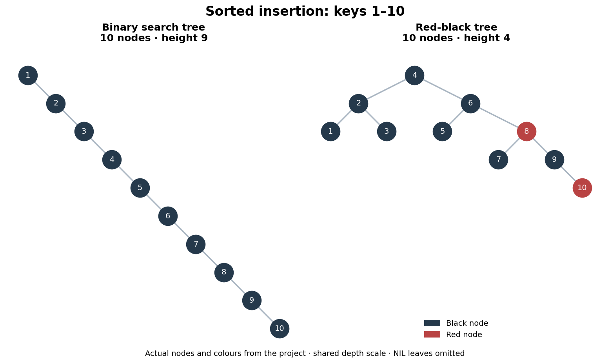

# BST and red-black trees

A two-person Algorithms project at ICAI implementing an ordinary binary search
tree and a red-black tree. We insert the same keys in sorted and shuffled orders
to compare their height and leaf depth, then test insertion, lookup and deletion.

[Run the comparison](#how-to-run) · [Results](#what-the-comparison-shows) · [Repository structure](#repository-structure)



*The project's classes build both trees from ten integer keys. Sorted insertion
turns the BST into a chain; the red-black tree has height four. Red nodes show
its actual colours. Black NIL leaves are omitted.*

## What the comparison shows

With the included 98-word fixture, `python compare_trees.py --seed 42` produces:

| Insertion order | Tree | Height | Mean leaf depth |
|---|---|---:|---:|
| Sorted | BST | 97 | 97.000 |
| Sorted | Red-black | 10 | 6.020 |
| Shuffled | BST | 11 | 7.647 |
| Shuffled | Red-black | 7 | 5.841 |

The red-black tree stays shorter for both orders in this example. Height counts
edges, so a single node has height zero. These are structural measurements,
not timings or averages across many shuffles.
[The saved CSV](results/sample_comparison.csv) includes the full measurements.

## How to run

Use Python 3.12 from this folder. The trees, comparison and tests need only the
standard library. If your interpreter is named `python3.12` rather than
`python`, use that command in the examples below.

```bash
python compare_trees.py --seed 42
python compare_trees.py --prefix a --prefix b --order shuffled --seed 42
python -m unittest discover -s tests -v
```

To use another permitted UTF-8 word list or save the output:

```bash
python compare_trees.py --words data/sample_words.txt --prefix a --seed 42
python compare_trees.py --seed 42 --output comparison.csv
```

The loader removes duplicate words. Prefix matching ignores case, while stored
keys retain their spelling. It accepts up to three prefixes and 400 words per
prefix. `--output` replaces the named file; its parent folder must already exist.
The course dictionary is not included.

## Implementation

Both trees support insertion, lookup, deletion and traversal using course-derived
node interfaces. The red-black tree adds a shared black NIL sentinel, rotations
and recolouring after insertion and deletion. Reinserting a key replaces its
value; keys must be mutually comparable and cannot be `None`.

`is_balanced_tree()` checks whether child heights differ by at most one at every
node. This is stricter than red-black validity: a valid red-black tree need not
pass that check.

## Repository structure

```text
bst-red-black-trees/
├── binary_tree.py                  # BST operations, metrics and a deletion example
├── red_black_tree.py               # Red-black operations, rotations and fix-up rules
├── compare_trees.py                # Shared insertion orders and CSV comparison
├── preview.py                      # Drawing script for the comparison figure
├── requirements.txt                # No third-party packages
├── requirements-visualisation.txt  # Matplotlib, for the optional drawing script
├── data/
│   └── sample_words.txt            # Input fixture
├── results/
│   └── sample_comparison.csv       # Saved measurements
├── docs/
│   ├── technical-notes.md          # Interfaces, metric conventions and drawing command
│   └── images/                     # Comparison figure
└── tests/
    └── test_trees.py               # Ordering, links, counts and red-black invariants
```

Start with `compare_trees.py` to follow the experiment, then inspect the two
tree classes. [Technical notes](docs/technical-notes.md) explain the interfaces,
metric conventions and optional drawing command.

## Tests and limits

The test command above checks constructed cases, insertion/deletion combinations
and seeded mixed operations. It validates ordering, parent links, values, counts
and red-black properties; finite tests are not a proof for all inputs.

Recursive BST operations can exceed Python's recursion limit on a long chain.
Some traversal helpers have quadratic worst-case costs. This is a teaching
implementation, rather than a performance-tuned container library. The teaching
handout is not included.
