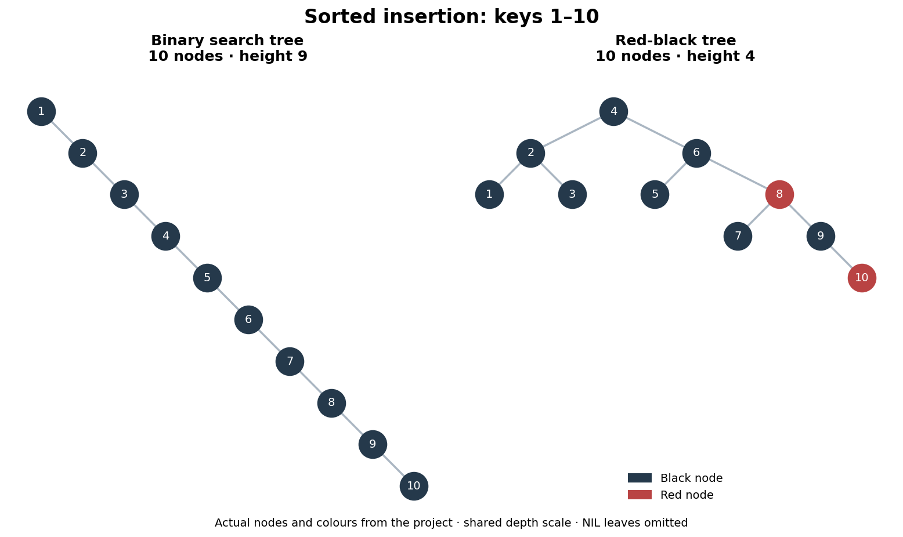

# BST and red-black trees

We compare an ordinary binary search tree (BST) with a red-black tree (RBT),
inserting the same keys in sorted and shuffled orders. Both implementations
support insertion, lookup, deletion and traversal. The comparison measures how
insertion order changes tree height and leaf depth.



An executed example using the project's tree classes and ten synthetic integer
keys. Both drawings use the same depth scale. Red nodes show the RBT's actual
colours; black NIL leaves are omitted. Matplotlib draws the nodes and edges; it
does not build or balance the trees.

## Run the comparison

Checked with **Python 3.12.2 on macOS** and **Python 3.12.14**. The algorithms, examples and tests use only the
standard library. Run these commands from this project folder:

```bash
python compare_trees.py --seed 42
python compare_trees.py --prefix a --prefix b --order shuffled --seed 42
python -m unittest discover -s tests -v
```

The first command prints CSV for the included 98-word fixture:

```text
prefix,order,seed,tree,nodes,height,height_balanced,mean_leaf_depth
(all),sorted,42,BST,98,97,False,97.0
(all),sorted,42,RBT,98,10,False,6.020408
(all),shuffled,42,BST,98,11,False,7.647059
(all),shuffled,42,RBT,98,7,False,5.840909
```

The sorted BST has one leaf at depth 97. The RBT stays shorter, but neither tree
passes the stricter height-balance test on this fixture. These are structural
measurements, not timings. The [historical CSV](results/sample_comparison.csv)
is kept separately. Fresh runs on 23 and 26 October 2026 produced the same CSV
bytes, including the macOS run.

To save a new comparison or use another permitted UTF-8 word list:

```bash
python compare_trees.py --seed 42 --output comparison.csv
python compare_trees.py --words data/sample_words.txt --prefix a --seed 42
```

`--output` replaces the named file; its parent directory must already exist.
Replace the fixture path with your own file, one word per line. The loader
removes identical duplicates and accepts unsorted input. Prefix matching ignores
case, while stored keys keep their spelling. The command accepts up to three
prefixes and at most 400 words per prefix. The course dictionary is not included.

## How the trees work

The BST follows key comparisons down the tree. The RBT adds a shared black NIL
sentinel, rotations and recolouring to restore red-black invariants after
insertion and deletion. Reinserting a key replaces its value; `None` is reserved
for missing nodes. Keys must be mutually comparable.

Height counts edges: an empty tree has height −1 and one node has height 0.
Mean leaf depth includes real leaves only. `is_balanced_tree()` checks whether
child heights differ by at most one at every node; this is a different property
from red-black validity. The shuffled order is one seeded example, not an
average across random orders.

## Recreate the drawing

Use a separate environment for the optional visualisation:

```bash
python -m venv .venv
source .venv/bin/activate
python -m pip install --upgrade pip
python -m pip install -r requirements-visualisation.txt
python preview.py
```

On Windows Command Prompt, activate with `.venv\Scripts\activate`.
The checked environment used pip 26.2.2 and Matplotlib 3.11.2. `preview.py`
calls `build_trees()` and replaces `docs/images/tree-comparison.png`.

## Code and limitations

| Location | Purpose |
|---|---|
| `binary_tree.py`, `red_black_tree.py` | Tree operations and metrics; each also runs a small deletion example |
| `compare_trees.py`, `data/` | Shared insertion orders, CSV measurements and the word fixture |
| `preview.py`, `tests/` | Drawing and structural checks |

All seven tests pass with both checked Python versions.
They check ordering, parent links, values, counts and red-black invariants,
including 14,400 insertion/deletion combinations per tree on five keys and
20,000 seeded mixed operations across both trees. These finite checks are not
a proof for all inputs.

Recursive BST operations can exceed Python's recursion limit on a long chain.
Some traversal helpers have quadratic worst-case costs. The comparison is a
small teaching experiment, not a performance-tuned container library.
[Technical notes](docs/technical-notes.md) explain the interfaces and previous
post-submission corrections.

## Academic context

An Algorithms team project at iMAT, ICAI, Universidad Pontificia Comillas,
set as an assignment for pairs. We use course-derived node interfaces. The
teaching handout and original dictionary are not included.
